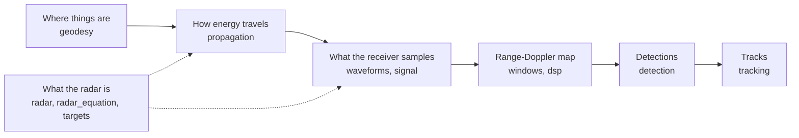

# radar-forge user guide

This guide explains what each part of `radar_forge.core` does, the equations behind it, and
how to try it out. It is for anyone new to the library: new staff, interns and students who
know Python and NumPy and some signals. You don't need to have built a radar before.

Each page covers one stage of the chain below. Read them in order the first time, because each
stage uses what the one before it produced.

## The chain

| Page | Modules | Read it to learn |
| :-- | :-- | :-- |
| [1. The radar and its link budget](01-radar-and-link-budget.md) | `constants`, `targets`, `radar`, `radar_equation` | How much power comes back, how much noise it competes with, and the two limits (range and velocity) that decide what a radar can see |
| [2. Geometry and propagation](02-geometry-and-propagation.md) | `geodesy`, `propagation` | How a latitude and longitude become a range and an angle, and how a target's position and motion become a delay and a Doppler shift |
| [3. Waveforms and signals](03-waveforms-and-signals.md) | `waveforms`, `signal` | The chirp, how range turns into a beat frequency, and how the library builds the complex samples a receiver records |
| [4. Range-Doppler processing](04-range-doppler-processing.md) | `windows`, `dsp`, `ambiguity_resolution` | How two FFTs turn those samples into a map of range against velocity, what a taper costs, and how two PRFs undo folding |
| [5. Detection](05-detection.md) | `detection` | How CFAR decides which cells of the map hold a target, at a false-alarm rate you choose |
| [6. Tracking](06-tracking.md) | `tracking/` | How detections from scan after scan become tracks |

Every page has the same sections in the same order: what the stage does, a table of quantities
and equations with a worked value, how it works step by step, a short example to run, a
scenario to try it in, things that look like bugs but aren't, limits, and references.

## Conventions used on every page

- **SI units, with the unit in the name.** `range_m`, `carrier_frequency_hz`, `rcs_dbsm`. When a
  page says "range" it means metres.
- **Linear inside, decibels at the edge.** Every calculation is linear. Decibels appear only
  where a number enters or leaves the library, and the name says so (`gain_tx_dbi`,
  `noise_figure_db`).
- **East-north-up (ENU) coordinates**, centred on the radar: x is east, y is north, z is up.
  Azimuth is measured clockwise from north, and elevation up from the horizon.
- **Closing is positive.** A target coming towards the radar has a positive radial velocity and
  a positive Doppler shift.
- **Physical constants come from `radar_forge.core.constants`**: c is `SPEED_OF_LIGHT_MPS`,
  k is `BOLTZMANN_JPK`. Never type 3e8. It is 0.07 % high, which puts a target 70 cm out at
  1 km.
- **Data cubes are `(n_pulses, n_samples)`**: slow time (one row per chirp) on axis 0, fast time
  (samples within a chirp) on axis 1.

## Notation

Each symbol means the same thing on every page.

| Symbol | Meaning | Unit | In the code |
| :-- | :-- | :-- | :-- |
| $c$ | speed of light | m/s | `SPEED_OF_LIGHT_MPS` |
| $k$ | Boltzmann's constant | J/K | `BOLTZMANN_JPK` |
| $T_0$ | standard noise temperature, 290 K | K | `STANDARD_NOISE_TEMPERATURE_K` |
| $f_c$ | carrier frequency, the centre of the band | Hz | `carrier_frequency_hz` |
| $\lambda$ | wavelength, $c / f_c$ | m | `wavelength_m` |
| $B$ | swept bandwidth | Hz | `bandwidth_hz` |
| $T_c$ | chirp (or pulse) duration | s | `chirp_duration_s` |
| $\alpha$ | sweep rate, $B / T_c$ | Hz/s | `sweep_rate_hzps` |
| $\mathrm{PRF}$ | chirp repetition frequency | Hz | `prf_hz` |
| $f_s$ | receiver sample rate | Hz | `sample_rate_hz` |
| $P_t$ | transmitted power | W | `transmit_power_w` |
| $G_t$, $G_r$ | transmit and receive antenna gain | linear | `gain_tx_linear`, `gain_rx_linear` |
| $\sigma$ | radar cross-section (RCS) | m² | `rcs_m2` |
| $F$ | receiver noise figure | linear | `noise_figure_linear` |
| $R$ | range, radar to target | m | `range_m` |
| $R_t$, $R_r$ | transmitter-to-target and target-to-receiver range | m | `range_tx_m`, `range_rx_m` |
| $\beta$ | bistatic angle, at the target between the two sites | rad | `bistatic_angle_rad` |
| $v_r$ | radial velocity, closing positive | m/s | `radial_velocity_mps` |
| $\tau$ | round-trip delay | s | `delay_s` |
| $f_d$ | Doppler shift | Hz | `doppler_hz` |
| $f_b$ | beat frequency after the FMCW deramp | Hz | `beat_frequency_hz` |
| $N$ | chirps in one coherent processing interval (CPI) | — | `n_pulses` |
| $P_{fa}$ | probability of false alarm | — | `pfa` |
| $\alpha_{\mathrm{cfar}}$ | CFAR threshold factor. The code's docstrings write it $\alpha$; the subscript keeps it apart from the sweep rate | — | `cfar_threshold_factor` |

A page may add a symbol of its own. When it does, it defines it in its own table.

## Which scenario to try each page in

The scenarios in `scenarios/` are complete, runnable set-ups built from these modules. Each is
a TOML file you can read and edit. Each page of this
guide ends by sending you to one of them, with one setting to change and what to look for.

| Scenario | Pages it exercises | Run it with |
| :-- | :-- | :-- |
| [001, X-band](../../scenarios/scenario_001_fmcw_low_prf.toml): one site, three waveforms | 1, 2, 3, 4 | `uv run python scripts/run_scenario.py scenarios/scenario_001_fmcw_low_prf.toml --out out/s1` |
| [002, bistatic](../../scenarios/scenario_002_bistatic_xband.toml): two sites | 1, 2, 3 | `uv run python scripts/run_scenario.py scenarios/scenario_002_bistatic_xband.toml --out out/b1` |
| [003, tracking](../../scenarios/scenario_003_tracking.toml): detection and tracking | 5, 6 | `uv run python scripts/run_scenario.py scenarios/scenario_003_tracking.toml --out out/t1` |

Set up once with `uv sync --extra dev --extra visualisation`. Add `--frames 10` to any run for
a quick look.

Want an open problem to work on? See the [intern research tasks](../../interns/README.md). Each
page links to the tasks that build on it.

## Where to go next

- The module docstrings hold the full derivations, and every page links to them. In Python,
  `help(radar_forge.core.dsp)` shows one.
- [`spec/`](../../spec/) says what the library is meant to do; where a page and a spec disagree,
  the spec wins.
- [`docs/conventions/style.md`](../conventions/style.md) explains the naming rules used above.
